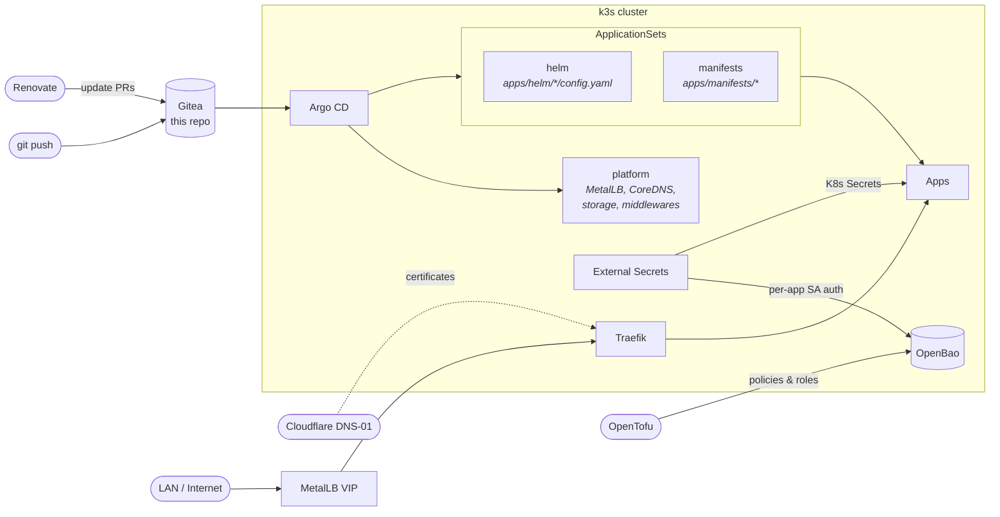
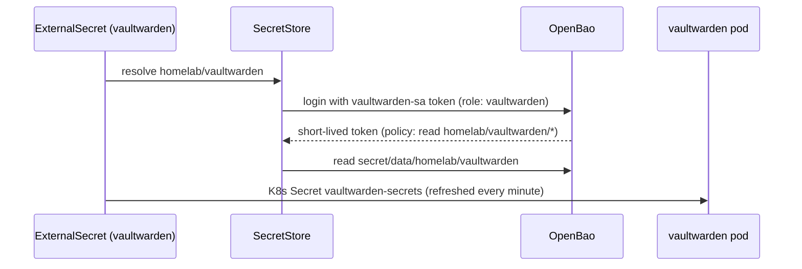

# Homelab

A self-hosted Kubernetes platform running ~30 services for my day-to-day life: photos, files,
passwords, documents, media, chat and more. It is managed entirely through GitOps. Every resource in
the cluster is declared in this repository and reconciled by Argo CD.

I built and run it to practise production-style infrastructure on hardware I own: declarative
deployments, centralised secret management, SSO, TLS everywhere, network segmentation, and
monitoring.

## Highlights

- **GitOps end to end.** A single bootstrap `Application` hands control to Argo CD, which then
  manages itself, the platform layer, and every app through two `ApplicationSet`s. Adding a service
  means adding a folder. Nothing is applied by hand.
- **No secrets in Git.** Secrets live in [OpenBao](https://openbao.org) (an open-source Vault fork)
  and are synced into the cluster by [External Secrets Operator](https://external-secrets.io). Each
  app authenticates with its own Kubernetes ServiceAccount and can read only its own path.
- **Secret access as code.** OpenBao policies and Kubernetes auth roles are generated per app by
  [OpenTofu](https://opentofu.org) from a single map, so access is least-privilege by default.
- **Single sign-on.** [Authentik](https://goauthentik.io) is the identity provider, and apps such as
  Vaultwarden, Paperless, Linkwarden and Sharry log in through OIDC.
- **Secure ingress.** Traefik terminates TLS with Let's Encrypt certificates obtained through
  Cloudflare DNS-01. HTTP is redirected to HTTPS, and most services sit behind an IP allowlist
  middleware so they are only reachable from the LAN.
- **Real client IPs.** MetalLB (L2) replaces k3s's built-in service load balancer. Together with
  `externalTrafficPolicy: Local` and the PROXY protocol from the upstream proxy, applications see
  the real source address.
- **Observability.** Prometheus scrapes node-exporter, kube-state-metrics, cAdvisor, the API server
  and annotated pods. A [Grafana dashboard](dashboards/k3s-cluster.json) is versioned here.
- **Automated upkeep.** [Renovate](https://docs.renovatebot.com) opens PRs for container image and
  Helm chart updates against my self-hosted Gitea.

## Architecture



### How deployments work

1. [`argocd/bootstrap/root.yaml`](argocd/bootstrap/root.yaml) is the only manifest applied
   manually. It points Argo CD at the `argocd/` directory (app-of-apps).
2. That directory defines the `homelab` [AppProject](argocd/projects/homelab.yaml), which restricts
   source repos, and the [`platform`](argocd/applications/platform.yaml) app for cluster-wide config.
3. Two ApplicationSets generate one Argo CD `Application` per service:
   - [`manifests`](argocd/appsets/manifests.yaml) uses a directory generator over
     `apps/manifests/*`, so every folder of plain YAML becomes an app.
   - [`helm`](argocd/appsets/helm.yaml) uses a file generator over `apps/helm/*/config.yaml`. Each
     config declares the chart, version, namespace, optional `ignoreDifferences` and whether to
     auto-sync. The folder's extra manifests (IngressRoutes, secrets) are deployed alongside the
     chart as a second source.
4. Apps auto-sync with `prune` and `selfHeal`, so drift is reverted. Critical infrastructure
   (Argo CD itself, OpenBao, Traefik, External Secrets) is set to manual sync to avoid
   self-inflicted outages.

### How secrets work



Each app ships a `service-account.yaml`, a `secretstore.yaml` and an `external-secret.yaml`. The
matching OpenBao role and policy come from [`tofu/openbao/apps.tf`](tofu/openbao/apps.tf), where
onboarding a new app is one map entry.

## Tech stack

| Layer | Tools |
| --- | --- |
| Kubernetes | k3s, MetalLB, local-path provisioner (`Retain` StorageClass), NFS persistent volumes from a NAS |
| GitOps | Argo CD (app-of-apps, ApplicationSets, multi-source Helm), Gitea, Renovate |
| Ingress & networking | Traefik (IngressRoute CRDs, middlewares, ACME DNS-01), Cloudflare, Twingate, AdGuard Home |
| Security | OpenBao, External Secrets Operator, Authentik (OIDC SSO), Vaultwarden |
| Infrastructure as code | OpenTofu (Vault provider) |
| Observability | Prometheus, Grafana, node-exporter, kube-state-metrics, Matomo |

## Services

| Category | Services |
| --- | --- |
| Identity & security | Authentik, Vaultwarden, OpenBao |
| Files & documents | Seafile (+ SeaDoc), Paperless-ngx, AFFiNE, Sharry, ConvertX, Mermaid Live Editor |
| Photos & media | Immich, Jellyfin, Tdarr, Seerr, Sonarr, Radarr, Prowlarr, FlareSolverr, qBittorrent (VPN-routed through a Gluetun sidecar), MeTube |
| Communication | Matrix Synapse |
| Productivity | Actual Budget, Linkwarden, Atuin sync server |
| Dev & ops | Gitea, Argo CD, Portainer, Harbor, Grafana, Prometheus |
| Network | Traefik, AdGuard Home (DNS), Twingate connector |

## Repository layout

```
.
├── argocd/
│   ├── bootstrap/root.yaml      # the one manually applied manifest
│   ├── projects/                # AppProject with allowed sources and destinations
│   ├── applications/            # standalone Applications (platform)
│   └── appsets/                 # ApplicationSets generating one app per service
├── apps/
│   ├── manifests/<app>/         # plain Kubernetes YAML per service
│   └── helm/<app>/              # config.yaml (chart + options), values.yaml, extra manifests
├── platform/                    # cluster-wide config: MetalLB, CoreDNS, storage, Traefik middlewares
├── tofu/openbao/                # OpenBao policies and Kubernetes auth roles
├── dashboards/                  # Grafana dashboards as JSON
└── docs/cluster-setup.md        # bootstrapping the cluster from bare nodes
```

## Adding a service

1. Create `apps/manifests/<app>/` with a Deployment, Service, PVC and an IngressRoute (add the
   `internal-only` middleware unless it should be public).
2. If it needs secrets, add a ServiceAccount, SecretStore and ExternalSecret, write the values to
   `secret/homelab/<app>` in OpenBao, add the app to `tofu/openbao/apps.tf`, and run `tofu apply`.
3. Commit and push. Argo CD picks up the new folder and deploys it.

## Getting started

[`docs/cluster-setup.md`](docs/cluster-setup.md) walks through rebuilding the cluster from bare
nodes: k3s, MetalLB, Argo CD, initialising OpenBao, and the bootstrap order that resolves the
dependency between Traefik and OpenBao. After that, Argo CD reconciles everything from this
repository.
